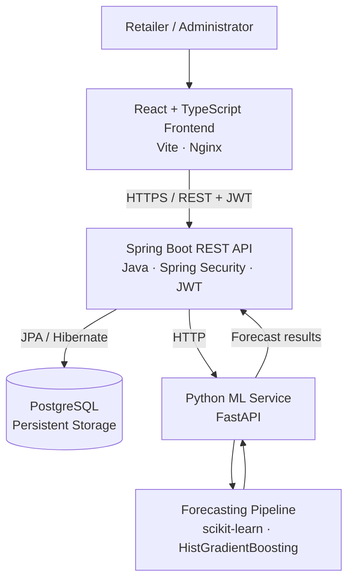

# ShelfSense
### Retail Inventory Intelligence & Forecasting

**A full-stack inventory and supply-chain management platform built with Java Spring Boot, React, PostgreSQL, and machine learning.**

ShelfSense helps retailers manage inventory across multiple locations, track stock movements, coordinate procurement, handle reservations, and generate demand forecasts and replenishment recommendations.

---

## System Architecture



### Architecture Overview

| Layer | Technology | Responsibility |
|---|---|---|
| Frontend | React, TypeScript, Vite | User interface and application workflows |
| Backend | Java, Spring Boot | Business logic, REST APIs, authentication |
| Security | Spring Security, JWT | Authentication, role-based authorization |
| Database | PostgreSQL | Persistent application data |
| ORM | Spring Data JPA, Hibernate | Database access and entity management |
| Migrations | Flyway | Version-controlled database schema |
| ML Service | Python, FastAPI | Demand forecasting API |
| ML Pipeline | scikit-learn | Model training and evaluation |
| Infrastructure | Docker, Docker Compose, Nginx | Containerization and service orchestration |

---

## Core Features

### 1. Inventory Management
- Manage products and inventory across multiple locations.
- Record stock adjustments with transaction reasons.
- Maintain an inventory transaction ledger.
- Support idempotent inventory operations.
- Track inventory changes for auditability.

### 2. Multi-Location Operations
- Manage warehouses, distribution centres, and retail locations.
- Create and dispatch inventory transfers.
- Receive transfers, including partial receipts.
- Track transfer status and stock movement.

### 3. Inventory Reservations
- Reserve available inventory.
- Track reservation ownership and status.
- Prevent conflicting stock allocations through concurrency-safe operations.
- Handle reservation expiration.

### 4. Procurement Management
- Manage supplier information.
- Create and track purchase orders.
- Record goods receipts.
- Update inventory through procurement workflows.

### 5. Demand Forecasting
- Generate demand forecasts through a separate Python service.
- Train and evaluate forecasting models using historical sales data.
- Persist generated forecasts for application workflows.
- Compare model performance against a moving-average baseline.

### 6. Replenishment Intelligence
- Generate inventory replenishment recommendations.
- Calculate reorder requirements.
- Prioritize replenishment actions.
- Track recommendation statuses.

### 7. Authentication & Administration
- JWT-based authentication.
- Role-based access control with USER and ADMIN roles.
- Protected application workflows.
- Administrative account management and bootstrap support.

### 8. Dashboard
- Centralized inventory overview.
- Operational summaries.
- Inventory, procurement, transfer, and forecasting workflows.

---

## Machine Learning Pipeline

ShelfSense includes a separate forecasting microservice rather than embedding model inference inside the Spring Boot application.

```mermaid
flowchart LR
    A["Historical Sales Data<br/>Walmart M5"] --> B["Preprocessing"]
    B --> C["Feature Engineering"]
    C --> D["Chronological Train / Validation / Test Split"]
    D --> E["Model Training"]
    E --> F["Model Evaluation"]
    F --> G["Saved Model Artifacts"]
    G --> H["FastAPI Inference Service"]
    H --> I["Spring Boot Backend"]
    I --> J["Forecasting Dashboard"]
```



**Implementation details**
- Dataset: Walmart M5 sales dataset.
- Model: HistGradientBoosting.
- Baseline: 28-day Moving Average.
- Model artifacts and evaluation reports are maintained under `ml/artifacts/`.
- FastAPI exposes forecasting functionality to the backend.

**Evaluation transparency:** The current model achieved a WAPE of 78.82%, compared with 78.93% for the moving-average baseline. This is a marginal improvement, not evidence of high-accuracy demand prediction. Forecasting is an experimental intelligence component and should be evaluated further before operational use.

---

## Tech Stack

**Backend**
- Java
- Spring Boot
- Spring Security
- Spring Data JPA / Hibernate
- REST APIs
- JWT

**Frontend**
- React
- TypeScript
- Vite
- Nginx

**Database & Infrastructure**
- PostgreSQL
- Flyway
- Docker
- Docker Compose

**Machine Learning**
- Python
- FastAPI
- scikit-learn
- Pandas
- NumPy
- Joblib

---

## Getting Started

### Prerequisites

- Git
- Docker Desktop with Docker Compose
- Node.js and npm (for standalone frontend development)
- Java 21 (for standalone backend development)
- Python (for standalone ML development)

### 1. Clone the repository

```bash
git clone https://github.com/nisatsama/ShelfSense.git
cd ShelfSense
```

### 2. Configure environment variables

Create your local environment file:

```bash
cp .env.example .env
```

On Windows PowerShell:

```powershell
Copy-Item .env.example .env
```

Configure the required values in `.env`, including:

```env
SHELF_SENSE_JWT_SECRET=YOUR_BASE64_ENCODED_SECRET
SPRING_DATASOURCE_PASSWORD=YOUR_DATABASE_PASSWORD
```

Use a strong, randomly generated Base64 JWT signing key. Configure the database password to match your PostgreSQL setup.

Never commit `.env` or production secrets to Git.

### 3. Start the application

```bash
docker compose up --build -d
```

Check service status:

```bash
docker compose ps
```

View application logs:

```bash
docker compose logs -f
```

### 4. Access the application

| Service | Local URL |
|---|---|
| Frontend | http://localhost:3000 |
| Backend API | http://localhost:8080 |
| ML Service | http://localhost:8001 |
| PostgreSQL | localhost:5432 |

The backend API documentation is available at:

```text
http://localhost:8080/swagger-ui/index.html
```

### 5. Stop the application

```bash
docker compose down
```

To preserve your PostgreSQL data, do not add the `-v` flag.

For administrator bootstrap configuration, consult [`docs/ADMIN_BOOTSTRAP.md`](docs/ADMIN_BOOTSTRAP.md).

---

## Running Tests

### Backend

```powershell
.\mvnw.cmd test
```

### Frontend

```bash
cd frontend
npm install
npm test
npm run build
```

### Machine Learning Service

```bash
cd ml
pip install -r requirements.txt
python -m pytest
```

---

## Repository Structure

```text
ShelfSense/
├── frontend/
│   └── src/
│       ├── api/              # API client and types
│       ├── components/       # Shared UI components
│       ├── context/          # Authentication and notifications
│       └── pages/            # Application pages
│
├── src/main/
│   ├── java/com/nisatsama/shelfsense/
│   │   ├── account/          # Accounts and administration
│   │   ├── auth/             # Authentication and JWT
│   │   ├── dashboard/        # Dashboard APIs
│   │   ├── forecast/         # Forecast integration
│   │   ├── inventory/        # Inventory and transaction ledger
│   │   ├── location/         # Multi-location management
│   │   ├── procurement/      # Suppliers and purchase orders
│   │   ├── product/          # Product management
│   │   ├── replenishment/    # Replenishment recommendations
│   │   ├── reservation/      # Inventory reservations
│   │   ├── security/         # Authorization and security
│   │   └── transfer/         # Inventory transfers
│   └── resources/
│       ├── application.yml
│       └── db/migration/     # Flyway migrations
│
├── ml/
│   ├── src/
│   │   ├── api/              # FastAPI application
│   │   ├── data/             # Data downloading and preprocessing
│   │   ├── training/         # Model training
│   │   └── evaluation/       # Model evaluation
│   ├── artifacts/            # Model and evaluation artifacts
│   └── tests/
│
├── docs/                     # Architecture, API and setup documentation
├── docker-compose.yml
├── Dockerfile
└── README.md
```

---

## Engineering Highlights

- **Separation of concerns:** Independent frontend, backend, and ML service.
- **Concurrency safety:** Inventory reservation and allocation workflows designed to handle competing stock operations.
- **Data integrity:** Transactional inventory operations, database constraints, and version-controlled schema migrations.
- **Auditability:** Inventory transaction and adjustment records.
- **Security:** JWT authentication and role-based authorization.
- **Containerization:** Docker-based local environment for application services.
- **Testing:** Backend integration tests, frontend component/workflow tests, and ML unit/integration tests.

---

## Documentation

| Document | Description |
|---|---|
| [Architecture](docs/ARCHITECTURE.md) | System architecture and design |
| [API Reference](docs/API.md) | Backend API documentation |
| [Database Design](docs/database-design.md) | Database structure |
| [Setup Guide](docs/SETUP.md) | Development setup |
| [ML Pipeline](docs/ML_PIPELINE.md) | Model training and inference |
| [Dataset](docs/DATASET.md) | Dataset information |
| [Admin Bootstrap](docs/ADMIN_BOOTSTRAP.md) | Administrator initialization |
| [Project Audit](docs/PROJECT_AUDIT.md) | Implementation and audit notes |

---

## License

See [LICENSE](LICENSE) for details.

---

**Built by [Nisat Sama](https://github.com/nisatsama)**

[GitHub Repository](https://github.com/nisatsama/ShelfSense)