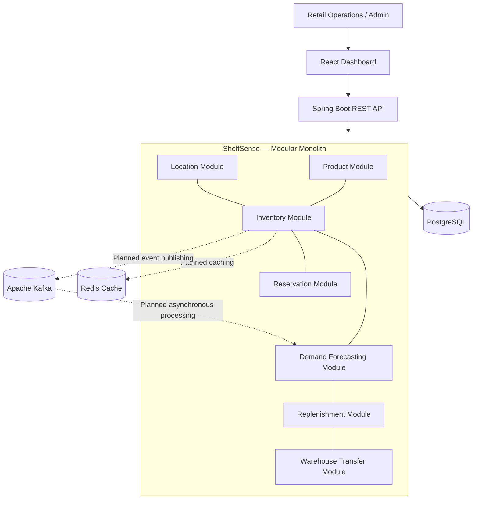
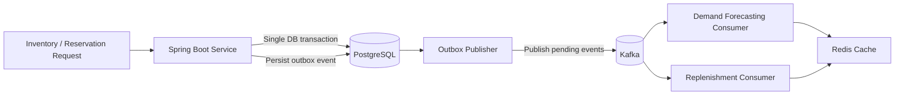
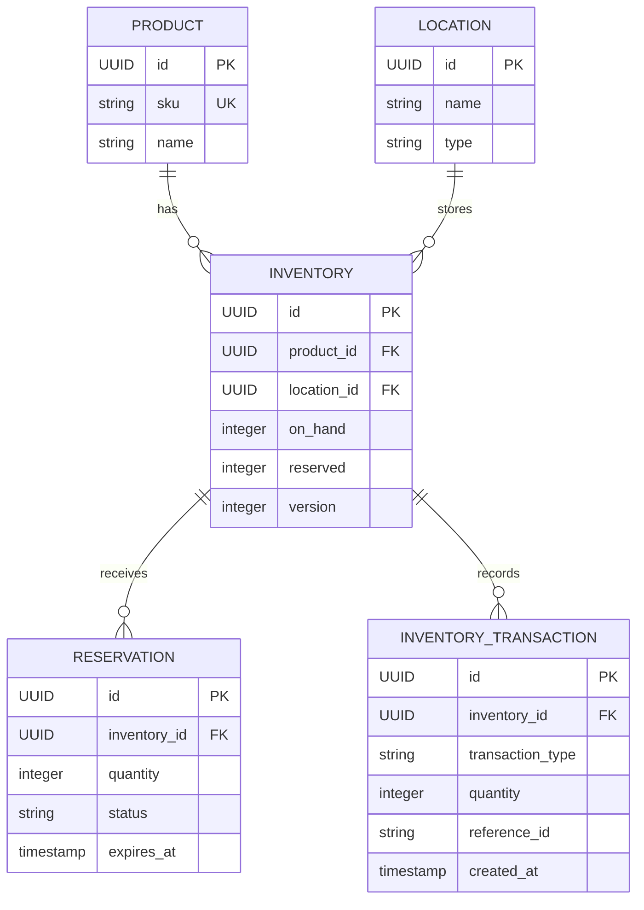
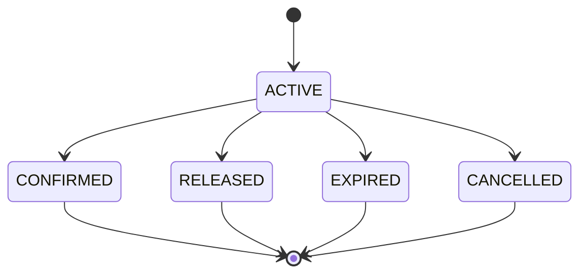

# ShelfSense

### Retail Inventory Intelligence & Replenishment Platform

**Predict stockouts. Optimize inventory. Make replenishment decisions before shelves go empty.**

ShelfSense is a Java-based retail inventory intelligence platform designed to help businesses monitor stock across warehouses, distribution centers, and retail stores.

Traditional inventory systems primarily report how much stock is available. ShelfSense aims to go further: analyze inventory movement, estimate when products may run out, and recommend when and where stock should be replenished.

The goal is to move inventory management from reactive stock tracking to proactive, data-driven decision-making.

---

## Table of Contents

- [Problem Statement](#problem-statement)
- [Solution](#solution)
- [Key Capabilities](#key-capabilities)
- [System Architecture](#system-architecture)
- [Technology Stack](#technology-stack)
- [Core Domain Model](#core-domain-model)
- [Inventory Management](#inventory-management)
- [Reservation Lifecycle](#reservation-lifecycle)
- [Demand Forecasting and Stockout Prediction](#demand-forecasting-and-stockout-prediction)
- [API Design](#api-design)
- [Database Design](#database-design)
- [Project Structure](#project-structure)
- [Getting Started](#getting-started)
- [Running Tests](#running-tests)
- [Engineering Roadmap](#engineering-roadmap)
- [Design Decisions](#design-decisions)
- [Contributing](#contributing)
- [License](#license)

---

## Problem Statement

Retail businesses operate across multiple inventory locations:

- Warehouses hold bulk inventory.
- Distribution centers distribute products across regions.
- Retail stores maintain customer-facing stock.
- Suppliers replenish inventory when stock runs low.

Managing these locations independently creates several operational problems.

**1. Unexpected stockouts**

A product may appear sufficiently stocked today but run out before the next replenishment arrives.

**2. Inventory fragmentation**

Stock may be available in one warehouse while another retail location experiences a shortage.

**3. Inaccurate available inventory**

Concurrent orders and reservations can cause inventory inconsistencies if stock updates are not handled correctly.

**4. Reactive replenishment**

Businesses often reorder products only after inventory reaches a critical threshold, increasing the risk of lost sales.

**5. Limited inventory visibility**

Without an auditable record of stock movements, investigating inventory discrepancies becomes difficult.

ShelfSense is being built to address these problems through reliable inventory operations and intelligent replenishment recommendations.

---

## Solution

ShelfSense introduces an inventory intelligence layer on top of conventional inventory management.

Consider a retail store with the following inventory:

| Metric | Value |
|---|---:|
| Product | Shampoo |
| Current stock | 120 units |
| Reserved stock | 15 units |
| Available stock | 105 units |
| Estimated demand | 5.5 units/hour |
| Supplier lead time | 24 hours |

Based on the estimated demand:

- Available stock: 105 units.
- Estimated time until stockout: approximately 19 hours.
- Expected supplier replenishment time: 24 hours.

The system can identify a potential stockout before the next supplier delivery and recommend an earlier replenishment or a transfer from another location.

*These figures illustrate the intended forecasting workflow; they are not a claim of currently deployed prediction functionality.*

---

## Key Capabilities

### Implemented foundations

- Product and location management.
- Inventory creation and lookup.
- Inventory quantities tracked using on-hand and reserved stock.
- Derived available inventory.
- Reservation creation.
- Reservation confirmation and release.
- Reservation lifecycle validation.
- PostgreSQL persistence.
- Flyway database migrations.
- Database-level inventory constraints.
- Optimistic locking using JPA `@Version`.
- PostgreSQL-backed integration tests for core inventory and reservation workflows.

### Planned capabilities

- Append-only inventory movement ledger.
- Verified concurrent reservation handling and conflict responses.
- Idempotent inventory operations.
- Reservation expiration and automatic stock release.
- Demand forecasting.
- Stockout prediction.
- Automated replenishment recommendations.
- Warehouse-to-store inventory transfers.
- Kafka-based event processing.
- Redis caching.
- Role-based access control.
- Operational monitoring and performance testing.
- React-based inventory intelligence dashboard.

---

## System Architecture

### Architectural approach

ShelfSense starts with a **modular monolith built using Spring Boot**.

The system separates business responsibilities into independent domain modules while keeping deployment and transaction management straightforward.

This approach allows the project to establish strong domain boundaries and transactional correctness before introducing distributed-system complexity.

### High-level architecture



*Solid connections represent the current architectural foundation. Dashed connections represent planned integrations.*

### Future event-driven architecture

As the system grows, selected operations can publish domain events through a transactional outbox.



The transactional outbox ensures that business data changes and corresponding event records are committed together. A separate publisher can subsequently deliver those events to Kafka.

This avoids relying on an unsafe dual-write operation between PostgreSQL and a message broker.

---

## Technology Stack

| Layer | Technology |
|---|---|
| Backend | Java 21, Spring Boot |
| API | Spring Web, REST |
| Persistence | Spring Data JPA, Hibernate |
| Database | PostgreSQL |
| Schema management | Flyway |
| Concurrency control | JPA Optimistic Locking |
| Build | Maven |
| Testing | JUnit, Spring Boot Test |
| Containerization | Docker, Docker Compose |
| Frontend | React (planned) |
| Caching | Redis (planned) |
| Event streaming | Apache Kafka (planned) |
| Monitoring | Prometheus, Grafana (planned) |

---

## Core Domain Model

ShelfSense is organized around the following business entities.



The inventory transaction entity and database table provide the foundation for a future auditable stock movement ledger. Complete ledger write paths and append-only enforcement are still planned.

---

## Inventory Management

Inventory is tracked independently for each product at each location.

Each inventory record maintains two primary quantities:

- `onHand`: Total physical stock currently recorded.
- `reserved`: Stock allocated to active reservations.

Available inventory is derived:

```text
available = onHand - reserved
```

Available stock is not stored as a separate database column.

### Example

| Metric | Quantity |
|---|---:|
| On-hand | 100 |
| Reserved | 25 |
| Available | 75 |

This avoids storing redundant inventory values that could become inconsistent.

### Inventory invariants

ShelfSense uses application-level validation and database constraints to protect inventory state.

- On-hand quantity cannot be negative.
- Reserved quantity cannot be negative.
- Reserved quantity cannot exceed on-hand quantity.
- A product-location inventory combination must be unique.
- Reservation quantities must be positive.

### Concurrency control

Inventory updates use JPA optimistic locking through the `@Version` field.

The intention is to prevent lost updates when multiple requests attempt to modify the same inventory record.

A transaction encountering a stale entity version must fail rather than silently overwrite a concurrent update.

Concurrent reservation behavior, transaction rollback, and consistent HTTP conflict handling are being verified through dedicated PostgreSQL-backed tests.

---

## Reservation Lifecycle

Reservations temporarily allocate inventory before a transaction is finalized.

### Reservation states



### Reservation operations

**Create reservation**

1. Validate the requested quantity.
2. Retrieve the inventory record.
3. Check available stock.
4. Increase reserved quantity.
5. Create an ACTIVE reservation.
6. Persist changes transactionally.

**Confirm reservation**

1. Verify that the reservation is ACTIVE.
2. Decrease on-hand quantity.
3. Decrease reserved quantity.
4. Mark the reservation CONFIRMED.

**Release reservation**

1. Verify that the reservation is ACTIVE.
2. Decrease reserved quantity.
3. Mark the reservation RELEASED.
4. Keep on-hand quantity unchanged.

### Example

Initial inventory:

```text
onHand  = 100
reserved = 0
available = 100
```

After reserving 20 units:

```text
onHand  = 100
reserved = 20
available = 80
```

After confirming the reservation:

```text
onHand  = 80
reserved = 0
available = 80
```

After releasing a reservation instead:

```text
onHand  = 100
reserved = 0
available = 100
```

Reservation expiration and automatic release are planned extensions.

---

## Demand Forecasting and Stockout Prediction

The forecasting module is planned to transform historical inventory movement and demand data into actionable stock recommendations.

### 1. Demand estimation

Initial forecasting approaches will include:

- Moving averages.
- Weighted moving averages.
- Exponential smoothing.

These provide explainable baselines before introducing more complex models.

### 2. Stockout prediction

A simplified stockout estimate is:

```text
Estimated time to stockout =
    Available inventory / Forecast demand per hour
```

For example:

```text
Available inventory = 105 units
Forecast demand     = 5.5 units/hour

Estimated stockout time = 19.09 hours
```

The actual model must account for changing demand, replenishment arrivals, seasonality, and inventory movements.

### 3. Reorder point calculation

A basic reorder point can be calculated as:

```text
Reorder Point =
    Demand During Lead Time + Safety Stock
```

### 4. Replenishment recommendations

The intended replenishment workflow:

1. Detect inventory approaching a stockout threshold.
2. Estimate demand during supplier lead time.
3. Calculate the required replenishment quantity.
4. Check whether another warehouse can supply the location.
5. Recommend an internal transfer when appropriate.
6. Otherwise recommend a supplier purchase order.

### Future ML integration

Machine learning may be introduced after sufficient historical demand data is available.

Potential approaches include time-series forecasting models, evaluated using chronological train/validation splits rather than random data splitting.

The goal is to improve prediction accuracy without sacrificing explainability or operational reliability.

---

## API Design

ShelfSense exposes REST APIs through Spring Boot.

The current API surface includes product, location, inventory, and reservation operations.

The following table describes the intended API organization; verify the actual endpoint mappings in the source code before relying on individual paths.

| Resource | Operation | Purpose |
|---|---|---|
| Products | POST /api/v1/products | Create product |
| Products | GET /api/v1/products | Retrieve products |
| Locations | POST /api/v1/locations | Create location |
| Locations | GET /api/v1/locations | Retrieve locations |
| Inventory | POST /api/v1/inventory | Create inventory |
| Inventory | GET /api/v1/inventory | Retrieve inventory |
| Reservations | POST /api/v1/reservations | Create reservation |
| Reservations | GET /api/v1/reservations | Retrieve reservations |
| Reservations | POST /api/v1/reservations/{id}/confirm | Confirm reservation |
| Reservations | POST /api/v1/reservations/{id}/release | Release reservation |

*These are representative resource mappings, not a substitute for the actual controller definitions.*

### API design principles

- Resource-oriented REST endpoints.
- DTOs instead of exposing persistence entities.
- Input validation.
- Consistent error responses.
- Explicit reservation state transitions.
- Transactional service-layer operations.
- API versioning through `/api/v1`.

---

## Database Design

PostgreSQL is the primary source of truth.

Flyway manages schema evolution through versioned SQL migrations.

Current migration history:

| Migration | Purpose |
|---|---|
| V1 | Core product, location, and inventory tables |
| V2 | Reservation table and related constraints |
| V3 | Inventory transaction table |

Hibernate schema generation is configured for validation rather than automatic schema creation.

```yaml
spring:
  jpa:
    hibernate:
      ddl-auto: validate
```

This keeps database schema changes explicit and version-controlled.

---

## Project Structure

The backend follows a domain-oriented package structure.

```text
ShelfSense/
│
├── src/
│   ├── main/
│   │   ├── java/com/nisatsama/shelfsense/
│   │   │   │
│   │   │   ├── common/
│   │   │   │   └── GlobalExceptionHandler.java
│   │   │   │
│   │   │   ├── product/
│   │   │   │
│   │   │   ├── location/
│   │   │   │
│   │   │   ├── inventory/
│   │   │   │
│   │   │   ├── reservation/
│   │   │   │
│   │   │   └── ShelfsenseApplication.java
│   │   │
│   │   └── resources/
│   │       ├── application.yml
│   │       └── db/
│   │           └── migration/
│   │               ├── V1__create_core_inventory_tables.sql
│   │               ├── V2__create_reservations_table.sql
│   │               └── V3__create_inventory_transactions_table.sql
│   │
│   └── test/
│       └── java/com/nisatsama/shelfsense/
│           ├── ShelfsenseApplicationTests.java
│           └── InventoryReservationIntegrationTests.java
│
├── infrastructure/
│   └── docker-compose.yml
│
├── docs/
│
├── .gitignore
├── mvnw
├── mvnw.cmd
├── pom.xml
└── README.md
```

---

## Getting Started

### Prerequisites

Install the following:

- Java 21 or compatible newer JDK.
- Docker Desktop.
- Git.

Maven is available through the included Maven Wrapper.

### 1. Clone the repository

```bash
git clone https://github.com/nisatsama/ShelfSense.git

cd ShelfSense
```

### 2. Start PostgreSQL

Start the database using Docker Compose:

```bash
docker compose -f infrastructure/docker-compose.yml up -d postgres
```

Verify the container:

```bash
docker compose -f infrastructure/docker-compose.yml ps
```

The local development database configuration currently uses:

```text
Database: shelfsense
Username: shelfsense
Password: shelfsense_dev
Port:     5432
```

Use these only for local development. Never reuse development credentials in production.

### 3. Configure datasource credentials

For PowerShell:

```powershell
$env:SPRING_DATASOURCE_URL = "jdbc:postgresql://localhost:5432/shelfsense"
$env:SPRING_DATASOURCE_USERNAME = "shelfsense"
$env:SPRING_DATASOURCE_PASSWORD = "shelfsense_dev"
```

For Linux/macOS:

```bash
export SPRING_DATASOURCE_URL=jdbc:postgresql://localhost:5432/shelfsense
export SPRING_DATASOURCE_USERNAME=shelfsense
export SPRING_DATASOURCE_PASSWORD=shelfsense_dev
```

### 4. Run the application

Windows:

```powershell
.\mvnw.cmd spring-boot:run
```

Linux/macOS:

```bash
./mvnw spring-boot:run
```

The application starts at:

```text
http://localhost:8080
```

### 5. Verify application health

```bash
curl http://localhost:8080/actuator/health
```

Expected response:

```json
{
  "status": "UP"
}
```

---

## Running Tests

Execute the complete test suite:

Windows:

```powershell
.\mvnw.cmd test
```

Linux/macOS:

```bash
./mvnw test
```

The integration tests use PostgreSQL-backed persistence and exercise core inventory and reservation workflows.

### Current verification status

The initial runtime baseline was verified locally:

- PostgreSQL 16 starts successfully using Docker Compose.
- Flyway validates and applies migrations V1–V3.
- Hibernate schema validation succeeds.
- Spring Boot starts successfully.
- Actuator reports application health as UP.
- The existing test suite passed with 9 tests, including 8 inventory/reservation integration tests.

Concurrency testing and additional business-logic coverage remain part of the engineering roadmap.

---

## Engineering Roadmap

ShelfSense is being developed incrementally, prioritizing correctness before infrastructure complexity.

| Phase | Milestone | Status |
|---|---|---|
| 1 | Core domain model and PostgreSQL persistence | Implemented |
| 2 | Product, location, inventory APIs | Implemented |
| 3 | Reservation lifecycle | Implemented |
| 4 | PostgreSQL-backed integration tests | Initial coverage implemented |
| 5 | Concurrent reservation correctness | In progress |
| 6 | Atomic inventory ledger and audit history | Planned |
| 7 | Idempotent inventory operations | Planned |
| 8 | Reservation expiration processing | Planned |
| 9 | Demand forecasting and stockout prediction | Planned |
| 10 | Replenishment and warehouse transfers | Planned |
| 11 | Kafka transactional outbox and event consumers | Planned |
| 12 | Redis caching and performance optimization | Planned |
| 13 | Authentication, authorization, and operational monitoring | Planned |
| 14 | React inventory intelligence dashboard | Planned |

---

## Design Decisions

### 1. Modular monolith before microservices

The initial system uses a modular monolith to keep business transactions manageable and deployment simple.

Service boundaries will be evaluated based on actual operational requirements rather than introduced prematurely.

### 2. PostgreSQL as the source of truth

Inventory quantities and reservations are persisted in a relational database with explicit constraints and transactional operations.

### 3. Derived available inventory

Available inventory is calculated rather than independently persisted:

```text
available = onHand - reserved
```

This avoids redundant state.

### 4. Optimistic locking for inventory updates

The `@Version` field provides a mechanism to detect concurrent updates to the same inventory record.

The application must still handle conflicts explicitly and verify the behavior through database-backed concurrency tests.

### 5. Transactional consistency

Inventory mutations and reservation state changes must succeed or fail together.

The future ledger and outbox write paths will follow the same transactional principle.

### 6. Explainable forecasting first

Forecasting will begin with understandable statistical baselines. More sophisticated ML models will be considered only when sufficient historical data exists to evaluate them meaningfully.

---

## Contributing

Contributions, bug reports, and suggestions are welcome.

1. Fork the repository.
2. Create a feature branch.
3. Make focused changes.
4. Add or update relevant tests.
5. Run the complete Maven test suite.
6. Submit a pull request describing the change.

For substantial architectural changes, document the motivation and trade-offs before implementation.

---

## License

A license has not yet been specified. Check the repository for licensing terms before reusing or distributing this project.

---

## Author

**Nisat Sama**

Java Backend Developer | Spring Boot | PostgreSQL | Distributed Systems

- GitHub: [@nisatsama](https://github.com/nisatsama)
- Project: [ShelfSense](https://github.com/nisatsama/ShelfSense)

*Building inventory systems that prioritize correctness, reliability, and intelligent decision-making.*
