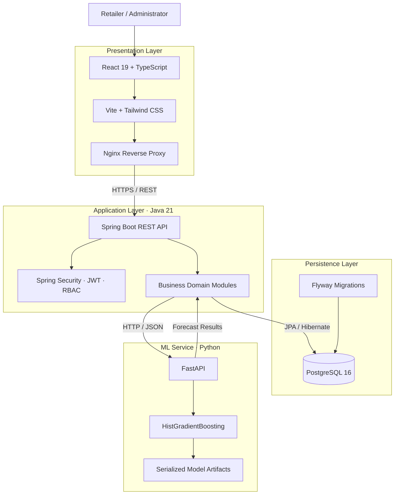

# ShelfSense
### Retail Inventory Intelligence & Demand Forecasting Platform

**ShelfSense is a full-stack retail inventory and supply-chain management platform built with Java, Spring Boot, React, PostgreSQL, and machine learning.**

It enables retailers to manage products and stock across multiple locations, coordinate procurement and inventory transfers, handle concurrent reservations, and generate demand forecasts and replenishment recommendations.

<p align="center">
  <a href="https://shelf-sense-wine.vercel.app/login"><strong>Live Demo</strong></a> ·
  <a href="https://github.com/nisatsama/ShelfSense"><strong>Source Code</strong></a> ·
  <a href="docs/API.md"><strong>API Reference</strong></a>
</p>

---

## Live Deployment

| Component | Deployment | Technology |
|---|---|---|
| Frontend | [ShelfSense Web App](https://shelf-sense-wine.vercel.app/login) | Vercel · React |
| Backend | [Spring Boot API](https://shelfsense-3icj.onrender.com/) | Render · Java |
| ML Service | [Forecasting API](https://shelfsense-ml-api.onrender.com/) | Render · FastAPI |

**Service endpoints**

- [Frontend Login](https://shelf-sense-wine.vercel.app/login)
- [Backend Health](https://shelfsense-3icj.onrender.com/actuator/health)
- [ML Health](https://shelfsense-ml-api.onrender.com/health)
- [ML API Documentation](https://shelfsense-ml-api.onrender.com/docs)

The application requires an administrator account provisioned through the administrator bootstrap configuration. Demo login credentials are not published in this repository.

---

## System Architecture

ShelfSense follows a modular monolith architecture for its core business operations, with a separately deployed Python forecasting microservice.



### Architecture Overview

| Layer | Technology | Responsibility |
|---|---|---|
| Frontend | React, TypeScript, Vite | Application interface and workflows |
| Styling | Tailwind CSS | Responsive application design |
| Backend | Java 21, Spring Boot 4.1.1 | Business logic and REST APIs |
| Security | Spring Security, JWT, BCrypt | Authentication and authorization |
| Persistence | PostgreSQL 16 | Relational data storage |
| ORM | Spring Data JPA, Hibernate | Entity management and database access |
| Migrations | Flyway | Version-controlled database schema |
| ML Service | Python, FastAPI | Forecast inference API |
| ML Pipeline | Pandas, NumPy, scikit-learn | Data processing, training and evaluation |
| Infrastructure | Docker, Docker Compose, Nginx | Containerization and service orchestration |

---

## Core Features

### 1. Inventory Management

- Product catalog with SKU-based identification.
- Inventory tracking across multiple locations.
- Stock initialization and manual adjustments.
- Adjustment reasons and audit records.
- Immutable inventory transaction ledger.
- Low-stock filtering and inventory summaries.
- Idempotent stock adjustment operations.

### 2. Multi-Location Inventory Operations

Supports three location types:

- Warehouses
- Distribution centres
- Retail stores

Transfer lifecycle:

```text
CREATED
   |
   v
APPROVED
   |
   v
DISPATCHED
   |
   v
IN_TRANSIT
   |
   v
PARTIALLY_RECEIVED
   |
   v
RECEIVED
```

Additional capabilities:

- Transfer approval and cancellation.
- Source inventory deduction during dispatch.
- Partial goods receipt.
- Damaged quantity tracking.
- Inventory ledger integration.

### 3. Inventory Reservations

- Reserve available stock against authenticated accounts.
- Track reservation ownership and status.
- Automatic 10-minute reservation expiry.
- Confirm or release active reservations.
- Prevent invalid inventory allocation.
- Pessimistic locking for reservation state transitions.
- Transactional inventory and ledger updates.

### 4. Procurement Management

- Supplier management and lead-time information.
- Purchase order creation and tracking.
- Purchase order approval and cancellation.
- Partial and full goods receipts.
- Automatic inventory updates upon receipt.
- Idempotent goods receipt operations.
- Procurement integration with inventory records.

### 5. Demand Forecasting

- Independent Python forecasting service.
- Historical sales data preprocessing.
- Feature engineering using sales, calendar and pricing information.
- Chronological training, validation and test splits.
- Model comparison against statistical baselines.
- Single-product and batch forecasting APIs.
- Persisted forecast results in PostgreSQL.

### 6. Replenishment Intelligence

- Reorder point calculations.
- Safety stock calculations.
- Demand and supplier lead-time considerations.
- Prioritized replenishment recommendations.
- Recommendation approval and dismissal.
- Purchase order creation through approved replenishment workflows.

### 7. Authentication & Administration

- Stateless JWT authentication.
- HS256 token signing and validation.
- BCrypt password hashing.
- Role-based authorization (`ADMIN` and `USER`).
- Protected application endpoints.
- Account activation and deactivation.
- Administrator account management.
- One-time administrator bootstrap with persistent database state.
- Reservation ownership enforcement.

### 8. Operational Dashboard

A centralized dashboard with 11 operational application views covering:

- Dashboard overview
- Product catalog
- Location management
- Inventory
- Stock adjustments
- Reservations
- Transfers
- Suppliers
- Purchase orders
- Forecasting
- Replenishment

---

## Engineering & Backend Design

ShelfSense focuses on data integrity, transaction safety and business workflow correctness rather than simply implementing CRUD endpoints.

### Transactional Inventory Ledger

Inventory changes are accompanied by immutable transaction records.

Examples include:

| Operation | Ledger Transaction |
|---|---|
| Initial stock | `INITIAL_STOCK` |
| Stock adjustment | `ADJUSTMENT` |
| Reservation creation | `RESERVATION_CREATED` |
| Reservation confirmation | `RESERVATION_CONFIRMED` |
| Reservation release | `RESERVATION_RELEASED` |
| Transfer dispatch | `TRANSFER_OUT` |
| Transfer receipt | `TRANSFER_IN` |
| Purchase receipt | `PURCHASE_RECEIVED` |

Stock mutations and their corresponding ledger entries are performed within the same database transaction.

### Concurrency & Data Integrity

Inventory availability is derived rather than independently stored:

```text
available = on_hand - reserved
```

Database constraints enforce:

```sql
CHECK (on_hand >= 0);
CHECK (reserved >= 0);
CHECK (reserved <= on_hand);

UNIQUE (product_id, location_id);
```

Concurrency and consistency mechanisms include:

- Pessimistic row locking for critical state transitions.
- Optimistic locking using JPA `@Version`.
- Transactional inventory mutations.
- Database-level uniqueness constraints.
- Idempotency keys for retry-safe operations.
- Explicit reservation ownership checks.

### Security

- JWT-based stateless authentication.
- HS256 signature validation and token expiration.
- BCrypt credential hashing.
- Endpoint-level and method-level role authorization.
- Disabled-account validation on authenticated requests.
- Environment-based secret configuration.
- One-time administrator provisioning.

### ML Service Isolation

The Spring Boot backend communicates with FastAPI using HTTP through a dedicated forecasting client.

- Configurable connection and read timeouts.
- Independent model inference.
- Persisted forecast results.
- Graceful handling of unavailable forecasting services.
- Inventory operations remain separate from model inference failures.

---

## Machine Learning Pipeline

ShelfSense uses the Walmart M5 Forecasting dataset to experiment with retail demand prediction.

### Pipeline

```mermaid
flowchart LR
    A["Walmart M5 Dataset"] --> B["Data Preprocessing"]
    B --> C["Feature Engineering"]
    C --> D["Chronological Split"]
    D --> E["Model Training"]
    E --> F["Baseline Comparison"]
    F --> G["Held-Out Evaluation"]
    G --> H["Serialized Model"]
    H --> I["FastAPI Inference"]
    I --> J["Spring Boot Integration"]
    J --> K["Forecast Dashboard"]
```



### Dataset

**Walmart M5 Forecasting Accuracy**

The dataset contains historical retail sales, calendar events and selling prices across Walmart stores.

- 10 stores across California, Texas and Wisconsin.
- 3 product categories: FOODS, HOUSEHOLD and HOBBIES.
- Historical daily unit sales.
- Calendar and promotional information.
- Weekly selling prices.

The training pipeline uses a deterministic, stratified subset of 300 store-SKU series to make model training computationally manageable.

### Feature Engineering

The model uses 20 features, including:

- Historical sales lags: 1, 7, 14 and 28 days.
- Rolling demand averages and standard deviations.
- Calendar features and weekdays.
- Promotional indicators.
- Selling price and relative price.
- Product category, store and state encodings.

### Model & Evaluation

| Component | Implementation |
|---|---|
| Model | HistGradientBoostingRegressor |
| Loss function | Poisson |
| Baseline | 28-day Moving Average |
| Evaluation | Held-out chronological 28-day test period |
| Primary metric | WAPE |
| Model serialization | Joblib |
| Inference | FastAPI |

**Reported held-out evaluation:**

| Model | WAPE |
|---|---:|
| 28-day Moving Average | 78.93% |
| HistGradientBoosting | **78.82%** |

The improvement is marginal (0.11 percentage points). The model is experimental and should not be interpreted as a highly accurate production forecasting system.

Historical sales are not necessarily equivalent to unconstrained demand, particularly when stockout information is unavailable. The project does not fabricate stockout labels or confidence intervals.

Model artifacts and evaluation reports are maintained under `ml/artifacts/`.

For complete methodology, evaluation results and limitations, see [ML Pipeline Documentation](docs/ML_PIPELINE.md).

---

## Technology Stack

| Category | Technologies |
|---|---|
| Language | Java 21, TypeScript, Python |
| Backend | Spring Boot 4.1.1, Spring MVC |
| Security | Spring Security, JWT, BCrypt |
| Persistence | Spring Data JPA, Hibernate |
| Database | PostgreSQL 16 |
| Migrations | Flyway |
| Frontend | React 19, Vite 6 |
| Styling | Tailwind CSS 4 |
| Routing | React Router 7 |
| Charts | Recharts |
| HTTP Client | Axios, Spring RestClient |
| Machine Learning | scikit-learn, Pandas, NumPy |
| ML API | FastAPI, Uvicorn |
| Serialization | Joblib |
| Containerization | Docker, Docker Compose |
| Web Server | Nginx |
| Backend Testing | JUnit, Spring Boot Test |
| Frontend Testing | Vitest, React Testing Library |
| ML Testing | Pytest |

---

## Automated Testing & Verification

The repository's engineering verification report records the following results:

| Layer | Test Coverage | Reported Result |
|---|---|---|
| Backend | Integration and unit tests | 54/54 passed |
| Frontend | Component and workflow tests | 12/12 passed |
| ML Service | Unit and integration tests | 12/12 passed |
| **Total** | **All three application layers** | **78/78 passed** |

Backend tests cover authentication, administrator bootstrap, inventory ledger atomicity, reservations, procurement and forecasting integration.

Frontend tests cover application rendering and operational workflows.

ML tests cover forecasting request validation, inference and model artifact integration.

These figures represent recorded verification results, not a guarantee that every future deployment will pass.

---

## Getting Started

### Prerequisites

- Git
- Docker Desktop with Docker Compose
- Java 21
- Node.js 20+
- Python 3.12+
- npm

### 1. Clone the repository

```bash
git clone https://github.com/nisatsama/ShelfSense.git
cd ShelfSense
```

### 2. Configure environment variables

Create a local environment file:

**Linux / macOS**

```bash
cp .env.example .env
```

**Windows PowerShell**

```powershell
Copy-Item .env.example .env
```

Generate a Base64-encoded 256-bit JWT signing key:

```powershell
[Convert]::ToBase64String(
    [Security.Cryptography.RandomNumberGenerator]::GetBytes(32)
)
```

Configure the required values in `.env`:

```env
POSTGRES_DB=shelfsense
POSTGRES_USER=shelfsense
POSTGRES_PASSWORD=YOUR_DATABASE_PASSWORD

SHELF_SENSE_JWT_ISSUER=shelfsense
SHELF_SENSE_JWT_SECRET=YOUR_BASE64_ENCODED_SECRET

SHELF_SENSE_BOOTSTRAP_ADMIN_USERNAME=admin@example.com
SHELF_SENSE_BOOTSTRAP_ADMIN_PASSWORD=YOUR_STRONG_ADMIN_PASSWORD
```

Replace all placeholder values before starting the application.

Never commit `.env` or production credentials.

### 3. Start PostgreSQL

The root Docker Compose configuration uses an externally managed persistent PostgreSQL volume.

Initialize the database infrastructure first:

```bash
docker compose -f infrastructure/docker-compose.yml up -d
```

Verify that PostgreSQL is healthy:

```bash
docker compose -f infrastructure/docker-compose.yml ps
```

### 4. Build and start all services

From the repository root:

```bash
docker compose up --build -d
```

Check service status:

```bash
docker compose ps
```

View logs:

```bash
docker compose logs -f
```

The application consists of four services:

- PostgreSQL
- Spring Boot backend
- Python FastAPI forecasting service
- React frontend served through Nginx

The ML Docker image requires the trained model artifacts under `ml/artifacts/`.

### 5. Access the application

| Service | Local URL |
|---|---|
| Frontend | http://localhost:3000 |
| Backend API | http://localhost:8080 |
| Backend Health | http://localhost:8080/actuator/health |
| ML Health | http://localhost:8001/health |
| ML Documentation | http://localhost:8001/docs |
| PostgreSQL | localhost:5432 |

The backend API reference is maintained in [`docs/API.md`](docs/API.md).

### 6. Stop the application

```bash
docker compose down
```

To preserve PostgreSQL data, do not add the `-v` flag.

For administrator provisioning and security details, see [`docs/ADMIN_BOOTSTRAP.md`](docs/ADMIN_BOOTSTRAP.md).

---

## Running Tests Independently

### Backend

From the repository root:

```powershell
.\mvnw.cmd test
```

The backend integration tests require a reachable PostgreSQL database and the appropriate environment configuration.

### Frontend

```bash
cd frontend

npm install

npm test

npm run build
```

### Machine Learning Service

```bash
cd ml

python -m venv .venv
```

Activate the environment:

```powershell
.\.venv\Scripts\activate
```

Install dependencies:

```bash
pip install -r requirements.txt
```

Run tests:

```bash
python -m pytest -v
```

### Reproducing the ML Training Pipeline

The raw M5 dataset is not committed to the repository.

Configure Kaggle credentials if using the Kaggle CLI, or use the supported public dataset download fallback.

```bash
cd ml

python -m src.data.download

python -m src.data.preprocess

python -m src.training.train

python -m src.evaluation.evaluate
```

Start the inference service:

```bash
uvicorn src.api.main:app --host 0.0.0.0 --port 8001
```

---

## Repository Structure

```text
ShelfSense/
│
├── frontend/
│   ├── src/
│   │   ├── api/                 # API clients and TypeScript types
│   │   ├── components/          # Reusable UI components
│   │   ├── context/             # Authentication and notifications
│   │   ├── pages/               # Operational dashboard views
│   │   └── test/                # Vitest tests
│   ├── Dockerfile
│   └── nginx.conf
│
├── src/
│   ├── main/
│   │   ├── java/com/nisatsama/shelfsense/
│   │   │   ├── account/         # Account administration
│   │   │   ├── auth/            # Authentication
│   │   │   ├── common/          # Shared API infrastructure
│   │   │   ├── dashboard/       # Dashboard APIs
│   │   │   ├── forecast/        # ML service integration
│   │   │   ├── inventory/       # Inventory and transaction ledger
│   │   │   ├── location/        # Multi-location management
│   │   │   ├── procurement/     # Suppliers and purchase orders
│   │   │   ├── product/         # Product catalog
│   │   │   ├── replenishment/   # Replenishment engine
│   │   │   ├── reservation/     # Inventory reservations
│   │   │   ├── security/        # JWT and authorization
│   │   │   └── transfer/        # Inventory transfers
│   │   │
│   │   └── resources/
│   │       ├── application.yml
│   │       └── db/migration/    # Flyway V1–V11
│   │
│   └── test/                    # Backend tests
│
├── ml/
│   ├── src/
│   │   ├── api/                 # FastAPI application
│   │   ├── data/                # Dataset download and preprocessing
│   │   ├── training/            # Model training
│   │   └── evaluation/          # Model evaluation
│   ├── artifacts/               # Model and evaluation artifacts
│   ├── tests/                   # Pytest unit and integration tests
│   ├── Dockerfile
│   └── requirements.txt
│
├── infrastructure/
│   └── docker-compose.yml       # PostgreSQL infrastructure
│
├── docs/
│   ├── ARCHITECTURE.md
│   ├── API.md
│   ├── database-design.md
│   ├── DATASET.md
│   ├── ML_PIPELINE.md
│   ├── SETUP.md
│   └── ADMIN_BOOTSTRAP.md
│
├── .env.example
├── docker-compose.yml
├── Dockerfile
├── pom.xml
└── README.md
```

---

## Documentation

| Document | Description |
|---|---|
| [System Architecture](docs/ARCHITECTURE.md) | Architecture and engineering decisions |
| [API Reference](docs/API.md) | REST endpoints, methods and authorization |
| [Database Design](docs/database-design.md) | Relational schema and inventory invariants |
| [Setup Guide](docs/SETUP.md) | Local development and deployment setup |
| [ML Pipeline](docs/ML_PIPELINE.md) | Training methodology and evaluation |
| [Dataset Documentation](docs/DATASET.md) | Walmart M5 dataset and limitations |
| [Admin Bootstrap](docs/ADMIN_BOOTSTRAP.md) | Initial administrator provisioning |
| [Engineering Progress](docs/ANTIGRAVITY_PROGRESS.md) | Implementation milestones and verification results |

---

## Future Improvements

Potential next engineering milestones include:

- Demand forecasting improvements using stockout-aware historical data.
- Forecast uncertainty estimation and prediction intervals.
- Redis-based caching for frequently accessed inventory queries.
- Event-driven inventory updates for asynchronous workflows.
- Advanced reporting and inventory analytics.
- Observability with structured logging and metrics.
- Load testing and performance benchmarking.
- Automated CI/CD and deployment verification.

---

## License

This project is licensed under the MIT License. See [`LICENSE`](LICENSE) for details.

---

**Built by [Nisat Sama](https://github.com/nisatsama)**

[GitHub Repository](https://github.com/nisatsama/ShelfSense) · [Live Application](https://shelf-sense-wine.vercel.app/login)
