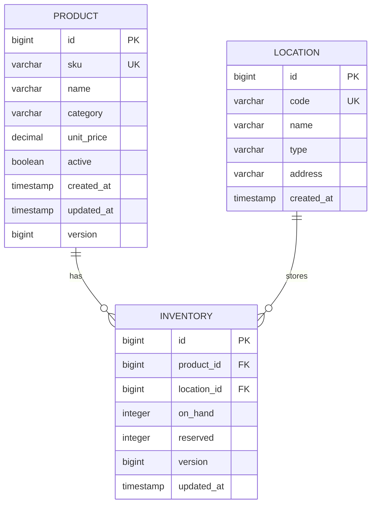

# Initial ERD



## Relationships

### Product → Inventory

One Product can have many Inventory records.

### Location → Inventory

One Location can have many Inventory records.

### Product + Location → Inventory

The combination of `product_id` and `location_id` must be unique.

This guarantees that a SKU has only one inventory state at a particular location.

## Inventory Invariants

```text
on_hand >= 0
reserved >= 0
reserved <= on_hand
UNIQUE(product_id, location_id)
```

Available inventory is derived:

```text
available = on_hand - reserved
```
